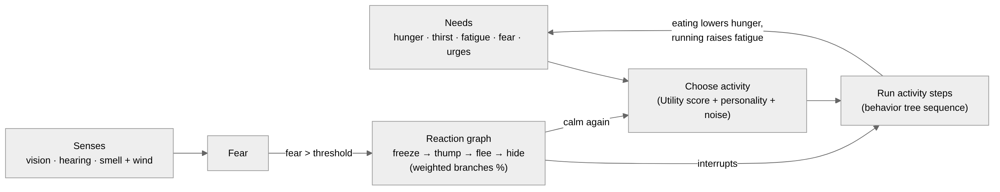

# Noetic — Living Wildlife (Vision)

Version 0.2 · Oct 16, 2026 · @heryk

## Goal

Noetic is an editor written in Rust + Bevy for creating animals that feel alive: they don't just walk from point A to point B — they sniff, watch, eat, drink, rest, get scared, mark their territory and react to each other like real animals.

The first version focuses on four species, each with a very different way of living:

| Species | Role in the ecosystem | Signature behavior |
| --- | --- | --- |
| Rabbit | Small prey, always alert | Short hops, stops, sniffs, stands up to watch, flees in zigzag |
| Deer | Large prey, lives in groups | Grazes with the head down and lifts it to watch, flees in leaps, the group follows the leader |
| Boar | Strong omnivore, in a sounder | Roots the ground for food, wallows in mud, may face or charge |
| Bird | Small, switches between ground and air | Hops on the ground pecking, flies to branches, sings, the flock takes off together |

Behavior is built and tested in the editor, exported to a `.noetic.ron` file and used in the game through the `noetic` crate. Everything is written in Rust; writing Rust code is optional for users and only needed to extend Noetic.

**Scope.** For now the focus is only these four animals, working really well. More species come over time and, later, humans. Features that humans will need (dialogue, schedules, planning) will be designed when the time comes. For now the core only has to keep that door open: needs, perception, memory and activities are already generic enough to grow.

## What makes an animal feel alive

An animal feels alive when it acts for its own reasons, never repeats exactly the same thing and reacts to what happens around it.

1. **Needs that change over time.** Hunger, thirst, fatigue and fear rise and fall on their own. The animal does something because it needs to, not because a script says so.
2. **Micro-behaviors.** Between actions there are pauses: sniffing the air, flicking an ear, scratching, looking around, standing still. This is what removes the robotic look.
3. **Variation and personality.** Timings, distances and choices have controlled randomness. Every individual has its own personality (fear, curiosity, sociable, appetite, energy, stubbornness, aggressiveness) generated from a seed, plus a few quirks.
4. **Limited perception.** The animal only reacts to what it sees, hears or smells, with realistic range, angle, light and wind. Sometimes it notices late, sometimes it gets scared for nothing.
5. **Memory of places.** It remembers where it found food and water and where it got scared, and avoids or returns to those spots. It gets used to a player who stays still.
6. **Daily rhythm.** Activity changes with the time of day: rabbits and deer are most active at dawn and dusk, birds sing in the morning, boars are nocturnal, everyone rests at some point.
7. **Group life.** Deer, boars and birds move together, stay close and pass the alarm to each other.
8. **Territory and conflict.** Animals leave scent marks (urine, glands, latrines, scrapes, rubs) that mean "safe", "territory" or "alert". Aggressive individuals of the same species fight; they get hurt, limp, heal and can die.
9. **Natural transitions.** Nothing changes abruptly. Before fleeing, the animal freezes and watches. Before lying down, it turns around a few times.

## How the animal decides

Needs choose what to do, a behavior tree runs it, and danger has priority over everything.



- **Needs** rise over time and each activity gets a score from them (Utility AI). The highest score wins, with a little randomness so it isn't predictable. Personality and routine change the scores.
- **Execution** of each activity is a short behavior tree: "drink carefully" = remember where water is, hop there, watch, drink, watch again.
- **Danger** doesn't wait for the next choice: when fear passes the threshold, the reaction graph takes over immediately. Each reaction can branch to several next reactions with a chance in % (e.g. freeze → 70 % thump, 30 % flee).
- **Results** of actions feed back into the needs: eating lowers hunger, running raises fatigue, and the cycle continues.

## Rabbit

The rabbit lives between eating and watching: it hops a few times, stops, sniffs, stands up to look and only then moves on.

**Needs:** hunger, thirst, fatigue, fear, safety (wish to stay near the burrow), urge to mark.

| Activity | When it happens | Details that bring it to life |
| --- | --- | --- |
| Hop in short bursts | Going to food, water or burrow | 2 to 5 hops, pause, new path; never a long straight line |
| Sniff the air and ground | Every pause, arriving somewhere new | Nose twitching, head goes down and up |
| Stand watch | Low but present fear, heard something | Rises on hind legs, ears turn to the sound, 1 to 4 s |
| Graze | High hunger, near grass or clover | Eats a few seconds, lifts the head, eats again |
| Drink carefully | High thirst | Goes to water more carefully than usual, watches before drinking |
| Groom | Full and calm | Licks paws, rubs ears |
| Rest | High fatigue, near or inside the burrow | Lies curled up, ears still alert |
| Dig | Near the burrow, bored | Digs a little and stops |
| Mark territory | Urge to mark | Urine, chin gland and latrines near the burrow (safe places) |

**Reactions**

- Something suspicious → freezes completely and watches
- Clear threat → thumps the ground (alarm for other rabbits) and flees in zigzag to the burrow or a bush
- After the scare → stays hidden for a while, comes out slowly, watches more than usual for a few minutes

**Personality:** high base fear; individuals vary between "shy" (flees early) and "bold" (lets you come closer).

## Deer

The deer spends the day grazing in a group, alternating head down eating and head up watching, and flees in leaps when one of the group raises the alarm.

**Needs:** hunger, thirst, fatigue, fear, closeness to the group.

| Activity | When it happens | Details that bring it to life |
| --- | --- | --- |
| Walk slowly | Moving between pastures | Calm steps, stops often, follows the group leader |
| Graze | High hunger, in a clearing | Head down for several seconds, lifts it and chews while looking around |
| Watch | Between bites, heard something | Head high, ears turning, stands still; at least one in the group is always watching |
| Browse leaves and shoots | Near bushes and low trees | Stretches the neck, pulls branches |
| Drink | High thirst | Goes to water as a group, they take turns drinking and watching |
| Ruminate lying down | After eating, high fatigue | Lies in a sheltered place, chews still, head up |
| Scratch and groom | Calm | Scratches with a hind leg or rubs on a trunk; males rub antlers (scent mark) |

**Reactions**

- Suspicion → stops, head high, stamps a front hoof, flicks the tail
- Threat → raises the tail (white signal for the group) and flees in high leaps, the group follows
- After → stops at some distance, looks back, slowly goes back to grazing

**Group:** a leader chooses the destination; the others keep a short distance and follow. Fawns stay close to the mother.

## Boar

The boar is the opposite of the rabbit: strong, noisy and confident; it spends time rooting the ground in a sounder and, when threatened, may flee or charge.

**Needs:** hunger, thirst, fatigue, heat (wish for mud), fear, urge to fight.

| Activity | When it happens | Details that bring it to life |
| --- | --- | --- |
| Trot | Moving between food areas | Snout close to the ground, the sounder in a loose line |
| Root the ground | High hunger, soft soil | Turns the soil with the snout, moves slowly, leaves marks on the ground |
| Sniff | Every pause | Snout up smelling the wind; trusts smell more than sight |
| Wallow in mud | High heat, near mud | Lies and rolls in the mud, stays a while |
| Rub on a tree | After the mud, calm | Rubs the body on a trunk (scent mark) |
| Drink | High thirst | Goes as a sounder, less careful than deer and rabbits |
| Rest | High fatigue, hot hours | The sounder lies together in a closed place |
| Fight | Two aggressive males close | Short shoves and grunts; damage, pain and limping, rarely death |

**Reactions**

- Suspicion → stops, sniffs hard, snorts
- Distant threat → the sounder flees together, noisily
- Close threat, cornered or protecting piglets → faces, scrapes the ground and may charge (aggressiveness × fear decide)
- After → goes back to rooting quickly; forgets the scare sooner than deer and rabbits

**Group:** females and piglets in a sounder; adult males more solitary. Piglets follow the mother in a line.

## Bird

The bird lives in two spaces, ground and air: it hops pecking, perches on branches, sings, and the whole flock takes off at the smallest scare.

**Needs:** hunger, thirst, fatigue, fear, urge to sing, closeness to the flock.

| Activity | When it happens | Details that bring it to life |
| --- | --- | --- |
| Hop on the ground | Looking for food | Two-footed hops, stops, tilts the head to look at the ground |
| Peck | Found something on the ground | Quick pecks, lifts the head between them |
| Fly to a branch | Medium fear, fatigue, urge to sing | Picks a nearby perch, lands with wing beats |
| Perch and observe | On the branch | Turns the head in quick, sharp moves |
| Sing | Morning and late afternoon, high perch | Sings in sequences, pauses, answers other birds |
| Drink and bathe | High thirst, puddle or shallow water | Drinks tilting the head back; sometimes gets wet and shakes its feathers |
| Preen | Calm, on the perch | Beak through the wings, shakes the body |
| Sleep | Night | Sheltered perch, head tucked in |

**Reactions**

- Suspicion → stops pecking, head high, a few alarm chirps
- Threat → immediate flight to the nearest branch or tree; the flock rises together
- After → watches from above and comes down slowly, one at a time

**Group:** loose flock on the ground; when one takes off scared, the others follow almost at the same moment.

## Perception and interaction between species

Each animal perceives the world through three senses with their own range, and the alarm signals of one species are understood by the others.

| Species | Vision | Hearing | Smell |
| --- | --- | --- | --- |
| Rabbit | Almost 360°, good for movement | Very good (ears turn to the source) | Good |
| Deer | Wide, good for movement | Very good | Very good, depends on the wind |
| Boar | Weak | Good | Excellent, depends on the wind |
| Bird | Excellent, also from above | Good | Weak |

**How perception works**

- Stimuli (player, noise, another animal) have an intensity; the closer and stronger, the faster the animal notices
- Movement draws more attention than something still: a crouched, still player in tall grass is noticed later
- Light matters: at night each species sees as well as its night vision allows
- Smell depends on the wind direction: coming downwind means being found earlier
- Noticing is not instant: fear builds up before the alarm, faster for fearful individuals

**Interaction between species**

- A flock of birds taking off puts rabbits and deer on alert
- A rabbit's thump and a deer's raised tail alert the neighbours
- An approaching boar makes rabbits and birds move away; deer only watch
- Animals share the same water: the more fearful ones wait for the bigger ones to leave

**Memory:** each animal remembers places with food, water and danger, and this memory fades over time (optional).

## Locomotion and animation

The way an animal moves is half of the realism: Noetic decides what the animal does and how it moves, and the game plays the matching animation.

| Species | Locomotion modes |
| --- | --- |
| Rabbit | Short hop, zigzag run, standing up |
| Deer | Walk, trot, escape leap |
| Boar | Walk, trot, straight run, charge |
| Bird | Ground hop, short flight, long flight, landing |

**Movement**

- Steering (acceleration, turning, obstacle avoidance) instead of teleporting along the path: nothing turns instantly
- Movement in "bursts": walk, stop, look, walk again, instead of continuous sliding
- Terrain changes speed (river, hill, mud); injured animals limp
- Pathfinding through the navigation crate the game already uses (navmesh); birds use perch points instead of navmesh in flight
- Groups: separation, alignment and cohesion so the flock moves together without colliding

**Animation**

- Noetic emits animation events (`sniff`, `stand_alert`, `graze`, `groom`, `dig`…) and the game maps each one to a clip of its model
- The editor exports the list of animation events for the 3D designer (Markdown or CSV)
- The animal's speed is exposed for the walk/trot/run blend
- Gaze direction (head turning to a sound) is exposed for the game to apply to the skeleton

## Editor and debug

The editor needs three things to make good wildlife: build the behavior, watch the animal live and understand why it did each thing.

**Build**

- Node graph (Bevy UI + Feathers widgets) for reactions and activity choice, with weighted branches in %
- Activities as reusable step sequences ("drink carefully" works for rabbit and deer)
- Species pages: body, health, senses, needs, base personality and variation, presets, routine, scent marks, 3D model clips
- Individuals: personality radar, traits, quirks, memories, and a reaction test that runs the real brain on an isolated copy

**Watch it live**

- 2D top-down test world with grass, bushes, water, mud, trees and burrows, editable while the animals live
- Spawn many animals of many species together
- A test player to try escapes, silent approach and wind
- Time control: pause, step, speed up, change the time of day
- 3D with the real models is seen inside the game through remote debug

**Understand**

- Live need bars and health for the selected animal
- Current activity and the score of each option (why it went to drink and not to eat)
- Vision, hearing and smell overlays, with the wind
- The animal's memory (where it remembers food, water and danger)
- Live tests during the simulation (make thirsty, scare with a noise, injure, heal)

The editor uses Bevy's own editor widgets (bevy_feathers) with the default dark theme, so the UI needs as little code as possible. The UI language is English.

## Architecture, file and runtime

The editor and the game use the same runtime, so the animal you test in the editor behaves the same inside the game; what goes from one to the other is one `.noetic.ron` file per species.


| Crate | What it does |
| --- | --- |
| `noetic_core` | Needs, perception, memory, fear, reaction graph, activity choice (Utility) and execution (behavior tree). No Bevy |
| `noetic` | The crate the game imports: plugin, components, systems, `.ron` loading, hot reload, steering and animation events; re-exports `noetic_core` |
| `noetic_editor` | The editor app, does not ship with the game |

**In the game**

```rust
commands.spawn((
    SceneRoot(assets.load("models/rabbit.glb#Scene0")),
    NoeticAgent::new(assets.load("ai/rabbit.noetic.ron")),
));
```

- The game maps animation events to the model's clips
- World points (water, burrow, mud, perch) are marked with components such as `WaterSource` and `Burrow`, which the animals find on their own
- Rust code is optional: you can create your own actions, senses and reactions when the editor is not enough

**Memory (blackboard):** each animal keeps its own memory (`hunger`, `threat`, `last_water_seen`…) that the senses write and the decisions read.

## Roadmap

Start with one very well made rabbit and only then multiply: everything the rabbit needs (needs, perception, micro-behaviors, escape) is the base for the other species. Detailed milestones are in the Requirements Definition (§9).

1. **Core.** Needs, memory, activity choice (Utility) and execution (BT), `.ron` format. Tests without the editor.
2. **Rabbit in the game.** A complete rabbit running in an example scene, still hand-written in `.ron`: hops, sniffs, watches, eats, drinks, flees.
   - Milestone: someone watches the rabbit for 2 minutes and does not notice a repeated pattern.
3. **Minimal editor.** Brain graph and 2D world with play/pause and live need bars. Recreate the rabbit in the editor.
4. **Full perception.** Vision, hearing and smell with wind and light; test player; overlays.
5. **Deer.** First group animal: leader, cohesion, shared alarm.
6. **Bird.** Flight, perches, singing, flock.
7. **Boar.** Rooting, mud, fights, and the choice between fleeing and charging.
8. **Ecosystem.** Interaction between species, day/night, scent marks, health, personalities, reaction test.
9. **Release.** Remote debug, Rust extension traits, `noetic` and `noetic_core` on crates.io, open-source editor, documentation and the example scene with the four species.

## Decisions and open questions

| Topic | Decision |
| --- | --- |
| Focus | Living wildlife: rabbit, deer, boar, bird |
| AI model | Needs + Utility to choose, behavior tree to execute, reaction graph with weighted branches for danger; FSM, GOAP and LLM are out for now (re-evaluate when humans come in) |
| Language | Everything in Rust |
| Editor UI | Native Bevy UI with bevy_feathers, default theme; English UI |
| Editor view | 2D top-down; 3D only through remote debug in the game |
| Navigation | Integrate existing crates (navmesh) |
| Format | One `.ron` per species |
| License | MIT/Apache-2.0, editor and runtime open source |

**Open** (tracked as Q1–Q5 and Q7 in the Requirements Definition)

- [ ] Is the game 3D with large terrain, or something smaller? Affects navigation and how many animals run at the same time
- [ ] How many simultaneous animals are expected (dozens or hundreds)? Decides whether animals far from the player run in a simplified mode
- [ ] Do predators (wolf, fox) come later, or is the player the only threat?
- [ ] Hunting: can the player hunt? This changes how much to invest in escape and injuries
- [ ] Does a herd share one memory, or only pass alarms?
- [ ] Is death permanent in the game?
