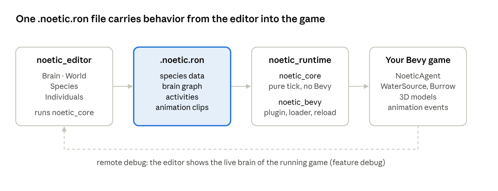

# Noetic — Requirements Definition (要件定義)

Version 0.3 · Oct 16, 2026 · @heryk

## 1. Overview (概要)

Noetic is an open-source editor, built in Rust + Bevy, for creating the behavior of game animals that feel alive. You test everything in a 2D world inside the editor itself and export the result to a `.noetic.ron` file, which the game loads through the `noetic` crate.

**Problem.** In Bevy, animal AI is usually written directly in code. Tuning it means recompiling, running the game and reproducing the situation. There is also no visual tool that brings authoring, testing and debugging together.

**v1 goal.** Wildlife that feels alive: animals act on their own needs, have individual personalities, perceive the world through limited senses, react to danger, live in groups, mark territory, fight, get hurt and follow a day/night routine.

**v1 scope.** Four ready-made species (rabbit, deer, boar, bird). Users can edit, delete or create any species and activity. Humans and generative AI come later (see section 8).

**References**

- Vision document: [00_vision.md](00_vision.md)
- Clickable prototype (HTML): [prototype/noetic_prototype.html](prototype/noetic_prototype.html), version 21 (English UI, Bevy Feathers default theme), 2026-10-16
- Design documents: [Basic Design](02_basic_design.xlsx) · [External Design](03_external_design.xlsx) · [Internal Design](04_internal_design.xlsx) · [Detailed Design](05_detailed_design.xlsx)

## 2. Users (対象ユーザー) and assumptions (前提条件)

| User | What they need | How they use Noetic |
| --- | --- | --- |
| Game designer | Tune behavior without programming | Builds the brain from blocks, adjusts numbers and tests in the World |
| Game programmer (Bevy) | Integrate the AI into the game and extend it | Adds `noetic`, loads the `.ron` and writes custom actions and senses in Rust |
| 3D modeler / animator | Know which animations to make | Receives the exported animation list (Markdown/CSV) |
| Community (public tool) | Create and share species | Creates species and activities and trades `.ron` files |

**Assumptions**

- The target game uses Bevy, at a version pinned per Noetic release.
- The editor and the game run the same runtime: behavior tested in the editor is the same in the game.
- The editor simulates in top-down 2D. 3D with the real models is viewed through remote debugging, inside the game.
- In-game navigation and pathfinding use existing crates (navmesh). Noetic does not implement its own 3D navigation.
- Rust code is optional: everything can be done in the editor, and programmers can extend it.

## 3. System overview (システム構成)



The editor and the game run the same `noetic_core`, so the file is the only thing that crosses over; remote debugging is the way back, for watching the brain inside the real 3D game.

| Crate | Role | Depends on Bevy? |
| --- | --- | --- |
| `noetic_core` | Data model, needs, Utility choice, behavior tree, reaction graph, perception; pure `tick` function, testable | No |
| `noetic` | The crate games add to `Cargo.toml`: plugin, components, `.noetic.ron` AssetLoader, hot reload, animation events; re-exports `noetic_core` | Yes |
| `noetic_editor` | The Bevy UI editor app: Brain, World, Species, Individuals | Yes |

## 4. Functional requirements (機能要件)

Each requirement has an ID so it can be cited in tasks and tests. Priority: **A** = v1 must-have, **B** = v1 nice-to-have, **C** = after v1. All A and B requirements are already demonstrated in the prototype.

### 4.1 Brain (behavior editor)

| ID | Requirement | Prio. |
| --- | --- | --- |
| FR-101 | Per-species graph editor with Root, Threat, Reaction, Choose activity (Utility) and Activity blocks | A |
| FR-102 | Connect blocks by dragging from an output dot to an input dot; disconnect by pulling the end or with Delete | A |
| FR-103 | Connection rules (e.g. Choose activity only connects to activities), cycle blocking, and a message explaining why | A |
| FR-104 | Warning for loose blocks that never run because they are not connected to the start | A |
| FR-105 | Branching reactions: several outputs with a % chance, typed or set by slider; always sums to 100% and the % is shown on the line | A |
| FR-106 | Reaction paths can merge back into the same reaction (acyclic graph) | B |
| FR-107 | Activity opened as a subgraph: Start + steps in sequence | A |
| FR-108 | Step with type, random min–max duration and an editable animation event | A |
| FR-109 | Activity with the need that drives it, a curve (linear, accelerating, fast start, on/off), a weight and a curve chart with the current value | A |
| FR-110 | Random choice variation per species (0–40%) | A |
| FR-111 | Drag activities, reactions and steps from the library into the graph; double-click adds at the end | A |
| FR-112 | "Follow animal": live-highlight the block an animal is running; if there is no animal, a button to spawn one | A |
| FR-113 | Live score of each activity on its block | B |
| FR-114 | Warning when an activity is shared by several species | B |
| FR-115 | Zoom, fit and pan the graph canvas | A |

### 4.2 World (test playground)

| ID | Requirement | Prio. |
| --- | --- | --- |
| FR-201 | Top-down 2D simulation, a 240 × 150 m world with river, ponds, mud, woods, hills, rocks, burrows, tall grass and clover | A |
| FR-202 | Camera with zoom (mouse wheel), drag and a clickable minimap | A |
| FR-203 | Play/pause, step, speed ½× to 16× (available in every area) | A |
| FR-204 | Day/night cycle with configurable length (5–40 real minutes), shortcuts for morning, noon, afternoon and night, and an activity band per species | A |
| FR-205 | Light affects vision according to the species' night vision | A |
| FR-206 | Tools: Select, Test player (standing/walking, cover in grass), Noise, Food and Add animal (choosing the species) | A |
| FR-207 | Layers: vision, hearing, path, scent marks, cover and names | A |
| FR-208 | Adjustable wind direction that affects smell | A |
| FR-209 | World editing: place, move, resize and delete tree, bush, rock, burrow, pond, mud, tall grass and clover; edit the river path; restore default; clear; undo | A |
| FR-210 | Animals keep living while the world is edited (new burrows become homes, deleted water makes them look elsewhere) | A |
| FR-211 | Selected-animal panel: current action, health, needs, activity scores, senses, memory and history | A |
| FR-212 | Animal tests: make thirsty, make hungry, tire, calm, noise nearby, scare, injure and heal/revive | A |
| FR-213 | Colored map; the surrounding interface stays neutral | A |

### 4.3 Species

| ID | Requirement | Prio. |
| --- | --- | --- |
| FR-301 | Species and activity library in user-created folders (VS Code style): create folder, rename (F2), duplicate, move, delete (Del) and undo | A |
| FR-302 | Built-in species and activities can be edited and deleted like any other | A |
| FR-303 | New species, blank or based on another, choosing name, color, routine, group, movement and folder | A |
| FR-304 | Body tab: color (palette + free picker), ground/bird, group (solitary, group with leader, flock) and shelter (burrow, bush, tree) | A |
| FR-305 | Body tab – Health: max health, pain resistance, healing per hour and limp threshold | A |
| FR-306 | Body tab – Locomotion: normal and flee speed | A |
| FR-307 | Mind tab – Senses: vision range, angle, hearing, smell and night vision | A |
| FR-308 | Mind tab – Needs: how fast hunger, thirst and fatigue rise per hour, and fear threshold | A |
| FR-309 | Mind tab – Base personality: mean and variation (±) of each trait, ready-made presets, create and delete presets, and re-roll animals already spawned | A |
| FR-310 | Routine & territory tab: routine (diurnal, crepuscular, nocturnal, morning and afternoon) and scent marking (types, meaning safe/territory/alert, frequency and duration) | A |
| FR-311 | 3D model tab: map each animation event to a clip of the model | A |
| FR-312 | Animation list for the 3D designer (event, what the animal does, duration, loop, where it is used, clip), copyable as Markdown or CSV | A |

### 4.4 Individuals

| ID | Requirement | Prio. |
| --- | --- | --- |
| FR-401 | Each animal has its own personality generated from a seed: Fear, Curiosity, Sociable, Appetite, Energy, Stubbornness and Aggressive ("Briguento") | A |
| FR-402 | Radar comparing the individual with the species average; traits editable by hand; apply a preset | A |
| FR-403 | Re-roll and lock the personality | A |
| FR-404 | Per-individual quirks (e.g. "always flees to the left"), add and remove | A |
| FR-405 | Learning by living: getting used to a still player, remembering where it was scared, remembering water and marks, with optional forgetting | A |
| FR-406 | Reaction test: set up a situation (player, noise or another species; distance; still/walking/running; in front/behind; wind) and see how each individual reacts, running the real brain on an isolated copy | A |
| FR-407 | Save test situations as cases that run automatically when behavior changes | C |

### 4.5 Simulated behavior (runtime)

| ID | Requirement | Prio. |
| --- | --- | --- |
| FR-501 | Needs (hunger, thirst, fatigue, heat, urge to sing, urge to mark, urge to fight) rise over time and drop with the right activity | A |
| FR-502 | Perception with range, angle, light, cover (tall grass), target movement and wind | A |
| FR-503 | Fear grows according to personality; above the threshold the animal follows the reaction graph | A |
| FR-504 | Spreading alarms: foot thumping, raised tail, chirping; other species also become alert | A |
| FR-505 | Groups with a leader (herd, flock) that walk, graze and flee together | A |
| FR-506 | Scent marking (urine, gland, latrine, scrape, rubbing); near its own marks fear drops faster | A |
| FR-507 | Fights between animals of the same species, driven by Aggressive and Stubbornness: the other fights back or flees | A |
| FR-508 | Health: damage from fights and charges, pain that causes fear, healing (faster when resting), limping and death | A |
| FR-509 | Per-species locomotion: hops with pauses, zigzag escape, flight and perching; terrain changes speed (river, hill) and ponds block | A |
| FR-510 | Routine: outside its active hours the animal prefers to rest | A |

### 4.6 Export and integration

| ID | Requirement | Prio. |
| --- | --- | --- |
| FR-601 | Export each species as `.noetic.ron` (see section 6) | A |
| FR-602 | Import `.ron` from a file or pasted text, with a clear message if the file is invalid | A |
| FR-603 | `noetic` crate: Bevy plugin, `NoeticAgent` component, asset loader, hot reload and animation events for the game | A |
| FR-604 | In-game world components (e.g. `WaterSource`, `Burrow`) so animals can find water and shelter | A |
| FR-605 | Remote debugging: the editor connects to the running game (feature `debug`, default address 127.0.0.1:15702) and shows the brain live | B |
| FR-606 | Rust extension: `NoeticAction`, `NoeticCondition`, `NoeticSensor`, `UtilityCurve`; nodes created in code appear in the editor | B |

### 4.7 Interface

| ID | Requirement | Prio. |
| --- | --- | --- |
| FR-701 | Fixed structure: area bar, Project panel, main area, Details panel, time bar at the top and status bar | A |
| FR-702 | Collapse panels (Ctrl+B and Ctrl+I) without breaking the layout | A |
| FR-703 | Hover tooltip on every control: what it is, what it changes and what it affects | A |
| FR-704 | Main buttons with icon and label; icon only where the meaning is obvious | A |
| FR-705 | Quick guide and shortcuts (Space, Ctrl+B, Ctrl+I, Delete, F2, mouse wheel) | A |
| FR-706 | Bevy Feathers default dark theme, unchanged (no custom styling); danger marked with the Feathers X-axis red; colored map | A |
| FR-707 | Undo for destructive actions (delete species, folder, terrain, preset) | A |

## 5. Non-functional requirements (非機能要件)

| ID | Category | Requirement | Prio. |
| --- | --- | --- | --- |
| NFR-01 | Determinism | Same seed + same inputs = same result, in the editor and in the game. Randomness only through the seeded PRNG | A |
| NFR-02 | Parity | The editor and the game run the same `noetic_core`; no behavior exists only in the editor | A |
| NFR-03 | Testability | `noetic_core` has no Bevy dependency and can be unit-tested with a plain `tick(dt)` | A |
| NFR-04 | Performance | Configurable brain tick rate (perception and choice do not need to run every frame); benchmarks in CI. Target number of simultaneous animals: to be defined (see section 10) | A |
| NFR-05 | File compatibility | `.noetic.ron` carries `schema_version`; older files are migrated on load, never silently broken | A |
| NFR-06 | Bevy version | Each Noetic release pins one Bevy version and documents the compatibility table | A |
| NFR-07 | License | Editor and runtime are open source under MIT OR Apache-2.0 (same license for both) | A |
| NFR-08 | Platforms | Editor binaries for Windows, Linux and macOS; runtime builds wherever Bevy builds | A |
| NFR-09 | Usability | Every control has a tooltip; main actions have icon + label; keyboard shortcuts for frequent actions | A |
| NFR-10 | Accessibility | Sufficient text contrast (Feathers default theme); nothing relies on color alone outside the map | B |
| NFR-11 | Safety of edits | Every destructive action can be undone; the reaction test runs on an isolated copy and never changes the world | A |
| NFR-12 | Robustness | An invalid `.ron` or a broken graph shows a clear message and never crashes the editor or the game | A |

## 6. Data requirements (データ要件)

### 6.1 Main entities

| Entity | What it holds | Where it lives |
| --- | --- | --- |
| Species | Name, color, movement (ground/bird), group type, shelter, speeds, senses, needs rates, fear threshold, health, base personality, routine, scent marks, brain, animation clips | `.noetic.ron` (one per species) |
| Activity | Driving need, curve, weight, steps (type, min–max seconds, animation event) | Inside the species file; shared activities are copied per species |
| Reaction | Action (freeze, alert, alarm, flee, hide, charge…), next reactions with weights | Inside the species brain (reaction graph) |
| Agent (individual) | Seed, traits, quirks, lock flag, health, needs, memory | Runtime only (spawned by the game); not exported |
| Personality preset | Name + trait values | Editor project |
| World | Terrain, water, river path, objects, wind, time of day | Editor project only; in the game the world comes from game components (`WaterSource`, `Burrow`…) |

### 6.2 `.noetic.ron` format

```ron
NoeticSpecies(
  schema_version: 1,
  species: "rabbit",
  color: "#D8D2C4",
  locomotion: Ground(hop: true, speed: 2.4, flee_speed: 9.0),
  group: Solitary,
  shelter: Burrow,
  routine: Crepuscular,
  senses: (vision: 30.0, angle: 340.0, hearing: 45.0, smell: 20.0, night_vision: 0.55),
  needs: (hunger_per_h: 25.0, thirst_per_h: 30.0, fatigue_per_h: 12.0, fear_threshold: 60.0),
  health: (max: 30.0, pain_resist: 0.2, heal_per_h: 4.0, limp_below: 0.4),
  personality: (
    base:      { "fear": 78, "curiosity": 38, "social": 30, "appetite": 50, "energy": 60, "stubborn": 30, "aggro": 25 },
    variation: { "fear": 18, "curiosity": 30, "social": 15, "appetite": 15, "energy": 15, "stubborn": 15, "aggro": 22 },
  ),
  scent_marks: [ (kind: Urine, meaning: Safe, every_min: 40.0, lasts_h: 48.0) ],
  brain: (
    threat: (
      first: [("freeze", 60), ("flee", 40)],
      reactions: {
        "freeze": (do: Freeze(secs: 2.0), next: [("thump", 70), ("flee", 30)]),
        "thump":  (do: Alarm(Thump),      next: [("flee", 100)]),
        "flee":   (do: Flee(to: Burrow),  next: [("hide", 100)]),
        "hide":   (do: Hide,              next: []),
      },
    ),
    choose: (noise: 0.15, options: ["graze", "drink", "rest", "watch", "groom", "dig", "mark"]),
  ),
  activities: {
    "graze": (need: Hunger, curve: Accelerating, weight: 1.0, steps: [
      (do: GoTo(Food), secs: (3.0, 8.0), anim: "hop"),
      (do: Eat,        secs: (2.0, 4.0), anim: "graze"),
      (do: Watch,      secs: (1.0, 2.5), anim: "watch"),
      (do: Eat,        secs: (2.0, 4.0), anim: "graze"),
    ]),
  },
  animation_clips: { "graze": "Rabbit_Eat", "watch": "Rabbit_Stand", "drink": "Rabbit_Drink" },
)
```

Values follow the built-in rabbit of the prototype (the 60 / 40 branch and the shortened option list are examples); the full schema with ranges and defaults is in the Detailed Design (sheet 6). Numbers can be tuned. Rules: weights in each `first`/`next` list sum to 100; reaction ids must exist; the reaction graph has no cycles; unknown fields are rejected with a message naming the line (NFR-12).

### 6.3 Other exports

- **Animation list for the 3D designer:** one row per animation event — event, what the animal does, duration, loop, where it is used, mapped clip — as Markdown or CSV.
- **Remote debug stream:** live agent state (current block, needs, fear, health) sent from the game to the editor; read-only.

## 7. Screen requirements (画面要件)

### 7.1 Layout

| Region | Position | Content |
| --- | --- | --- |
| Area bar | Far left, icons with labels | Brain, World, Species, Individuals |
| Project panel | Left, collapsible (Ctrl+B) | Folder tree of species and activities, or the tool list in World |
| Main area | Center | Graph editor, world map, species page or individuals page |
| Details panel | Right, collapsible (Ctrl+I) | Properties of whatever is selected (block, animal, terrain, trait) |
| Top bar | Top | Logo, play/pause, step, speed, world clock, panel toggles, Help, Connect to game |
| Status bar | Bottom | Run state, animal and species counts, day length, current species, selection, shortcut hints |

### 7.2 Areas

- **Brain** — species tabs, graph canvas with zoom/fit, library of activities/reactions/steps, Follow animal, warnings for loose blocks; double-click an activity to open its step subgraph.
- **World** — colored map with minimap and legend, tools (Select, Test player, Noise, Food, Add animal), layers, wind, world editing brushes, animal panel with tests (thirst, hunger, tire, calm, noise, scare, injure, heal).
- **Species** — four tabs: Body (color, movement, group, shelter, health, locomotion), Mind (senses, needs, base personality and presets), Routine & territory (routine, scent marks), 3D model (event → clip, animation list).
- **Individuals** — list of spawned animals; card with radar + traits, presets, re-roll and lock, quirks, memory; reaction test with situation builder and per-individual results.

### 7.3 Dialogs

| Dialog | Purpose |
| --- | --- |
| New species | Blank or copy of another; name, color, routine, group, movement, folder |
| Export | Preview and save `.noetic.ron` per species |
| Import | Load `.ron` from file or pasted text; validation messages |
| Connect to game | Address (default 127.0.0.1:15702), connection state, how to enable the `debug` feature |
| Animation list | Table for the 3D designer; copy as Markdown or CSV |
| Quick guide | What each area does and the keyboard shortcuts |

### 7.4 Visual style

The editor uses Bevy's own editor widgets (bevy_feathers) with the default dark theme, unchanged, so the UI needs as little code as possible: Feathers palette (window #1F1F24, panes #2A2A2E, accent #206EC9), 24 px rows, 4 px corners, Fira Sans / Fira Mono. Danger is marked with the Feathers X-axis red (#AB4051). The world map keeps its own colors so terrain and species are easy to tell apart. The UI language is English.

## 8. Constraints (制約条件) and out of scope (対象外)

**Constraints**

- Language and engine: everything is written in Rust; Bevy engine; the editor UI is built with Bevy UI + bevy_feathers (default theme).
- The editor is 2D only; 3D is seen in the game through remote debugging.
- In-game navigation uses existing navmesh crates.
- File format: RON.

**Out of scope for v1**

| Item | Status |
| --- | --- |
| Humans / human NPCs | Later phase; the architecture must not block them |
| LLM-driven behavior (`LlmProvider`) | Later; both local and API providers are planned |
| GOAP and FSM brain types | Later; v1 uses Utility + behavior tree + reaction graph |
| 3D view inside the editor | Not planned; remote debug covers it |
| Predators hunting prey | Open question (section 10) |
| Saved test cases that run automatically (FR-407) | Priority C |

## 9. Milestones (マイルストーン)

Phases are in order; dates are not set yet. Each phase ends with something that runs.

| # | Phase | Done when |
| --- | --- | --- |
| M1 | Core | `noetic_core` ticks needs, Utility choice and steps; unit tests pass with a fixed seed |
| M2 | Rabbit in the game | A Bevy test game loads `rabbit.noetic.ron` and the rabbit grazes, drinks, rests and flees |
| M3 | Minimal editor | Brain graph + World map; edit, test and export the rabbit |
| M4 | Perception | Vision, hearing, smell with wind, light, cover, habituation |
| M5 | Deer | Herd with leader, tail-flag alarm, group flight |
| M6 | Bird | Flight, perching, flock, singing, chirp alarm |
| M7 | Boar | Mud, rooting, charging, fights |
| M8 | Ecosystem | Day/night routines, scent marks, cross-species alarms, health, personalities and presets, reaction test |
| M9 | Release | Remote debug, Rust extension traits, docs, crates.io publish, editor binaries |

## 10. Open issues (課題・未決事項) and glossary (用語集)

### 10.1 Open issues

| # | Question | Notes |
| --- | --- | --- |
| Q1 | Map size in the game | Editor world is 240 × 150 m; real game maps may be much bigger (affects perception and performance) |
| Q2 | How many animals at once | Sets the performance target in NFR-04 |
| Q3 | Predators | Do animals hunt each other in v1, or only react to the player? |
| Q4 | Player hunting | Does the runtime need hit/damage events from the player's weapons? |
| Q5 | Shared group memory | Should a herd share one blackboard (e.g. a danger spot) or only pass alarms? |
| Q6 | UI language | **Decided:** English. Labels and messages go through a localization table so other languages can be added later |
| Q7 | Death in the game | Is death permanent, does the game respawn, or is it left to the game? |
| Q8 | Danger color | **Decided:** Feathers X-axis red (#AB4051) as a marker only |

### 10.2 Glossary

| Term | Meaning |
| --- | --- |
| Brain | The behavior of one species: threat reactions + activity choice + activities |
| Utility | Scoring each activity from its need and curve, then picking the best (with some randomness) |
| Behavior tree | The ordered steps inside an activity |
| Reaction graph | What the animal does when scared: weighted branches (%) from one reaction to the next |
| Blackboard / memory | What an individual remembers: water, scares, marks, the player |
| Need | A drive that rises over time (hunger, thirst, fatigue…) and is lowered by an activity |
| Trait | A personality value 0–100 (Fear, Curiosity, Sociable, Appetite, Energy, Stubbornness, Aggressive) |
| Quirk | A small individual habit (e.g. always flees to the left) |
| Preset | A saved set of trait values |
| Scent mark | Urine, gland, latrine, scrape or rub left in the world with a meaning (safe, territory, alert) |
| Runtime | The `noetic` crate the game uses (re-exports `noetic_core`) |
| RON | Rusty Object Notation, the file format |
| Remote debug | The editor watching a running game's brains live |
| Sandbox / reaction test | Running the real brain on an isolated copy to see a reaction without touching the world |
| Seed | Number that makes randomness repeatable |
